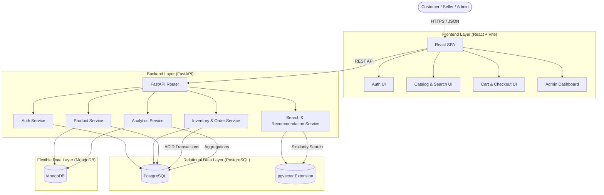

# Smart E-Commerce Platform - System Architecture

This document details the high-level architecture of the Smart E-Commerce Platform. The architecture is designed to support a transaction-safe, highly personalized shopping experience.

## 1. High-Level Architecture Diagram

## 2. Component Details

### 2.1 Frontend (React SPA)
The frontend is built using React (Vite) and Tailwind CSS, following the design system outlined in `DESIGN.md`. State is managed via Zustand.

- **Key Routes:**
  - `/`: Home (Personalized recommendations).
  - `/search`: Semantic search results.
  - `/product/:id`: Product details (PostgreSQL core + MongoDB specs).
  - `/cart`: Cart & Checkout flow.
  - `/admin/*`: Admin dashboard with KPIs and Charts.

### 2.2 Backend (FastAPI)
The backend is a modular monolithic FastAPI application, strictly enforcing separation of concerns between Routers, Services, and Repositories.

- **Authentication:** JWT tokens via PyJWT.
- **ORM:** SQLAlchemy for PostgreSQL. Motor for asynchronous MongoDB operations.
- **Validation:** Pydantic schemas.

### 2.3 Relational Database (PostgreSQL)
PostgreSQL handles all transactional and structured data.
- **Core Entities:** `users`, `products` (core pricing/stock info), `orders`, `order_items`, `inventory`.
- **Reasoning:** Enforces ACID compliance, guaranteeing that inventory is atomically deducted upon order creation without race conditions.

### 2.4 Vector Search (pgvector)
- **Role:** Stores 384-dimensional embeddings of product descriptions and titles.
- **Reasoning:** By keeping vectors alongside relational data, we can perform hybrid queries (e.g., "Find products semantically similar to X, but ONLY where `stock > 0`").

### 2.5 Flexible Document Store (MongoDB)
- **Role:** Stores flexible product specifications (e.g., laptops have RAM/CPU, shoes have size/color) and raw user interaction logs.
- **Reasoning:** Avoids sparse columns and anti-patterns like EAV (Entity-Attribute-Value) in the relational DB.

## 3. Core Workflows

### 3.1 Order Placement Flow
1. **Frontend:** User clicks "Place Order".
2. **Backend:** FastAPI initiates an SQLAlchemy transaction.
3. **Database (PostgreSQL):**
   - Locks the inventory row for the items (`SELECT ... FOR UPDATE`).
   - Checks if `available_stock >= requested_quantity`.
   - If False: `ROLLBACK`, return 400 Insufficient Stock.
   - If True: `INSERT` into `orders` and `order_items`.
   - `UPDATE` `inventory` (deduct stock).
   - `COMMIT`.

### 3.2 Semantic Recommendation Flow
1. **Trigger:** User performs a search or views a product.
2. **Embedding:** The backend (using an embedding model) converts the query into a vector.
3. **Similarity Search:** Query `pgvector` for Top-K similar product embeddings.
4. **Availability Filter:** `JOIN` with the `inventory` table to exclude out-of-stock items.
5. **Personalization:** Re-rank based on MongoDB user interaction history (e.g., boosting categories the user frequently buys).
6. **Response:** Return the enriched list, including "Why Recommended" explanations.
