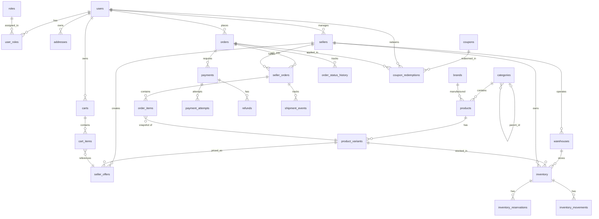

# Database Design

## PostgreSQL (Core Transactional Source of Truth)

### Tables & Columns

1.  **users**
    *   `id` (UUID, PK)
    *   `email` (VARCHAR, UNIQUE, INDEX)
    *   `hashed_password` (VARCHAR)
    *   `created_at` (TIMESTAMPTZ, default now())
    *   `updated_at` (TIMESTAMPTZ, default now())

2.  **roles**
    *   `id` (UUID, PK)
    *   `name` (VARCHAR, UNIQUE) e.g., 'CUSTOMER', 'SELLER', 'ADMIN'

3.  **user_roles**
    *   `user_id` (UUID, FK to users, ON DELETE CASCADE) - Cascade delete to cleanly remove roles when user is removed.
    *   `role_id` (UUID, FK to roles, ON DELETE CASCADE)
    *   *Constraint:* PRIMARY KEY (user_id, role_id)

4.  **addresses**
    *   `id` (UUID, PK)
    *   `user_id` (UUID, FK to users, ON DELETE CASCADE) - Addresses belong to a user.
    *   `line1`, `line2`, `city`, `state`, `postal_code`, `country` (VARCHAR)
    *   `is_default` (BOOLEAN)

5.  **categories**
    *   `id` (UUID, PK)
    *   `name` (VARCHAR, UNIQUE)
    *   `parent_id` (UUID, FK to categories, ON DELETE SET NULL) - Prevent deletion of parent from breaking child categories.

6.  **brands**
    *   `id` (UUID, PK)
    *   `name` (VARCHAR, UNIQUE)

7.  **products**
    *   `id` (UUID, PK)
    *   `name` (VARCHAR)
    *   `category_id` (UUID, FK to categories, ON DELETE RESTRICT) - Prevent deleting a category if products exist in it.
    *   `brand_id` (UUID, FK to brands, ON DELETE RESTRICT) - Prevent deleting a brand if products exist for it.
    *   `is_active` (BOOLEAN, default true)

8.  **product_variants**
    *   `id` (UUID, PK)
    *   `product_id` (UUID, FK to products, ON DELETE CASCADE) - Variants are deleted if the parent product is deleted.
    *   `sku` (VARCHAR, UNIQUE)
    *   `name` (VARCHAR) - e.g., "iPhone 15 - 128GB - Black"

9.  **sellers**
    *   `id` (UUID, PK)
    *   `user_id` (UUID, FK to users, ON DELETE RESTRICT) - The user managing the seller account.
    *   `company_name` (VARCHAR)
    *   `is_active` (BOOLEAN, default true)

10. **seller_offers**
    *   `id` (UUID, PK)
    *   `seller_id` (UUID, FK to sellers, ON DELETE CASCADE)
    *   `variant_id` (UUID, FK to product_variants, ON DELETE CASCADE)
    *   `price` (INTEGER) - minor units (paise)
    *   `is_active` (BOOLEAN, default true)
    *   *Constraint:* UNIQUE (seller_id, variant_id)

11. **warehouses**
    *   `id` (UUID, PK)
    *   `seller_id` (UUID, FK to sellers, ON DELETE CASCADE)
    *   `name` (VARCHAR)

12. **inventory**
    *   `id` (UUID, PK)
    *   `variant_id` (UUID, FK to product_variants, ON DELETE CASCADE)
    *   `warehouse_id` (UUID, FK to warehouses, ON DELETE CASCADE)
    *   `seller_id` (UUID, FK to sellers, ON DELETE CASCADE)
    *   `on_hand` (INTEGER, default 0)
    *   `reserved` (INTEGER, default 0)
    *   *Constraints:*
        *   CHECK (on_hand >= 0)
        *   CHECK (reserved >= 0)
        *   CHECK (on_hand >= reserved)
        *   UNIQUE (variant_id, warehouse_id, seller_id)

13. **inventory_reservations**
    *   `id` (UUID, PK)
    *   `inventory_id` (UUID, FK to inventory, ON DELETE CASCADE)
    *   `quantity` (INTEGER)
    *   `status` (VARCHAR) - ACTIVE, COMMITTED, RELEASED, EXPIRED
    *   `expires_at` (TIMESTAMPTZ)
    *   `order_id` (UUID, FK to orders, NULLABLE, ON DELETE SET NULL)

14. **inventory_movements**
    *   `id` (UUID, PK)
    *   `inventory_id` (UUID, FK to inventory, ON DELETE CASCADE)
    *   `quantity_change` (INTEGER)
    *   `reason` (VARCHAR) - RESERVE, COMMIT, RELEASE, MANUAL_ADJUST
    *   `created_at` (TIMESTAMPTZ, default now())

15. **carts**
    *   `id` (UUID, PK)
    *   `user_id` (UUID, FK to users, ON DELETE CASCADE)

16. **cart_items**
    *   `id` (UUID, PK)
    *   `cart_id` (UUID, FK to carts, ON DELETE CASCADE)
    *   `seller_offer_id` (UUID, FK to seller_offers, ON DELETE CASCADE)
    *   `quantity` (INTEGER)

17. **orders**
    *   `id` (UUID, PK)
    *   `user_id` (UUID, FK to users, ON DELETE RESTRICT)
    *   `status` (VARCHAR)
    *   `total_amount` (INTEGER)
    *   `currency` (VARCHAR, default 'INR')
    *   `created_at` (TIMESTAMPTZ, default now())

18. **seller_orders**
    *   `id` (UUID, PK)
    *   `order_id` (UUID, FK to orders, ON DELETE CASCADE)
    *   `seller_id` (UUID, FK to sellers, ON DELETE RESTRICT)
    *   `status` (VARCHAR)
    *   `subtotal` (INTEGER)

19. **order_items**
    *   `id` (UUID, PK)
    *   `seller_order_id` (UUID, FK to seller_orders, ON DELETE CASCADE)
    *   `variant_id` (UUID, FK to product_variants, ON DELETE RESTRICT) - Don't delete variants if order items reference them.
    *   `snapshot_price` (INTEGER)
    *   `snapshot_name` (VARCHAR)
    *   `quantity` (INTEGER)

20. **order_status_history**
    *   `id` (UUID, PK)
    *   `order_id` (UUID, FK to orders, ON DELETE CASCADE)
    *   `status` (VARCHAR)
    *   `created_at` (TIMESTAMPTZ, default now())

21. **payments**
    *   `id` (UUID, PK)
    *   `order_id` (UUID, FK to orders, ON DELETE RESTRICT)
    *   `amount` (INTEGER)
    *   `status` (VARCHAR)

22. **payment_attempts**
    *   `id` (UUID, PK)
    *   `payment_id` (UUID, FK to payments, ON DELETE CASCADE)
    *   `provider_ref` (VARCHAR)
    *   `status` (VARCHAR)
    *   `created_at` (TIMESTAMPTZ, default now())

23. **refunds**
    *   `id` (UUID, PK)
    *   `payment_id` (UUID, FK to payments, ON DELETE RESTRICT)
    *   `amount` (INTEGER)
    *   `status` (VARCHAR)

24. **shipment_events**
    *   `id` (UUID, PK)
    *   `seller_order_id` (UUID, FK to seller_orders, ON DELETE CASCADE)
    *   `status` (VARCHAR)
    *   `created_at` (TIMESTAMPTZ, default now())

25. **coupons**
    *   `id` (UUID, PK)
    *   `code` (VARCHAR, UNIQUE)
    *   `usage_limit` (INTEGER)
    *   `per_user_limit` (INTEGER)

26. **coupon_redemptions**
    *   `id` (UUID, PK)
    *   `coupon_id` (UUID, FK to coupons, ON DELETE CASCADE)
    *   `user_id` (UUID, FK to users, ON DELETE CASCADE)
    *   `order_id` (UUID, FK to orders, ON DELETE RESTRICT)
    *   *Constraint:* UNIQUE (coupon_id, user_id) - enforced conditionally if per_user_limit = 1

27. **reviews**
    *   `id` (UUID, PK)
    *   `product_id` (UUID, FK to products, ON DELETE CASCADE)
    *   `user_id` (UUID, FK to users, ON DELETE CASCADE)
    *   `rating` (INTEGER)
    *   `verified_purchase` (BOOLEAN, default false)
    *   *Constraint:* UNIQUE (user_id, product_id)

28. **returns**
    *   `id` (UUID, PK)
    *   `seller_order_id` (UUID, FK to seller_orders, ON DELETE RESTRICT)
    *   `status` (VARCHAR)

29. **return_items**
    *   `id` (UUID, PK)
    *   `return_id` (UUID, FK to returns, ON DELETE CASCADE)
    *   `order_item_id` (UUID, FK to order_items, ON DELETE RESTRICT)
    *   `quantity` (INTEGER)

30. **notifications**
    *   `id` (UUID, PK)
    *   `user_id` (UUID, FK to users, ON DELETE CASCADE)
    *   `message` (TEXT)
    *   `read` (BOOLEAN, default false)

31. **user_events**
    *   `id` (UUID, PK)
    *   `user_id` (UUID, FK to users, ON DELETE CASCADE)
    *   `event_type` (VARCHAR)
    *   `product_id` (UUID, FK to products, ON DELETE CASCADE)

32. **idempotency_keys**
    *   `id` (UUID, PK)
    *   `user_id` (UUID, FK to users, ON DELETE CASCADE)
    *   `endpoint` (VARCHAR)
    *   `key` (VARCHAR)
    *   `request_hash` (VARCHAR)
    *   `response_body` (JSONB)
    *   *Constraint:* UNIQUE (user_id, endpoint, key)

33. **outbox_events**
    *   `id` (UUID, PK)
    *   `topic` (VARCHAR)
    *   `payload` (JSONB)
    *   `processed` (BOOLEAN, default false)

34. **audit_logs**
    *   `id` (UUID, PK)
    *   `action` (VARCHAR)
    *   `entity_type` (VARCHAR)
    *   `entity_id` (UUID)
    *   `user_id` (UUID, FK to users, ON DELETE SET NULL)
    *   `created_at` (TIMESTAMPTZ, default now())

35. **embeddings (pgvector)**
    *   `id` (UUID, PK)
    *   `owner_type` (VARCHAR)
    *   `owner_id` (UUID)
    *   `chunk_index` (INTEGER)
    *   `content` (TEXT)
    *   `embedding` (vector(1536))
    *   `visibility` (VARCHAR)
    *   `seller_id` (UUID, FK to sellers, NULLABLE, ON DELETE CASCADE)
    *   `version` (INTEGER)
    *   `created_at` (TIMESTAMPTZ, default now())

## MongoDB (Flexible Content)

*   `product_content`: Long descriptions, marketing copy.
*   `product_specs`: Category-shaped attributes (e.g. { "ram": "16GB", "ssd": "512GB" } vs { "fabric": "Cotton" }).
*   `product_faqs`: Array of Q&A objects.
*   `knowledge_documents`: Source documents uploaded by sellers.
*   `knowledge_chunks`: Text chunks derived from documents.

## ERD (Mermaid)

